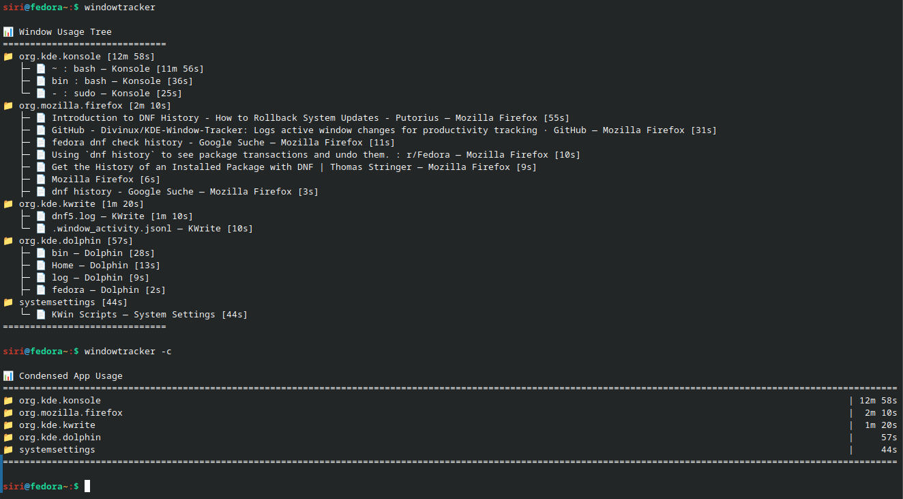

# KDE-Window-Tracker

CLI tool to log active window changes for productivity tracking similar to [ProcrastiTracker](https://strlen.com/procrastitracker/) and [ActivityWatch](https://activitywatch.net/). Works on KDE Plasma Wayland.

Tested on Arch2026.07.01, Debian 13, Fedora 44 with 

KDE Plasma 6.4.0 - 6.8.1



# Requirements

KDE Plasma 6+

systemd

Python 3.14+

qdbus (qdbus6)

Depending on distribution

python3-dbus

python3-gi

# Install
```bash
git clone https://github.com/Divinux/KDE-Window-Tracker.git
cd KDE-Window-Tracker
chmod +x installer.sh
./installer.sh
```

# Uninstall
```bash
cd KDE-Window-Tracker
chmod +x uninstaller.sh
./uninstaller.sh
```

# Usage
To display stats
```bash
windowtracker
```

To display condensed stats
```bash
windowtracker -c
```

# Addons
The addons directory contains an optional script which checks that 

1. The kwin script is installed and enabled,

2. The logger script is responsive

3. The systemd service is present and running

It can be sourced in for example .bashrc to alert in case anything breaks as such

```bash
if [ -f ~/KDE-Window-Tracker/addons/trackercheck ]; then
    . ~/KDE-Window-Tracker/addons/trackercheck
fi
```


